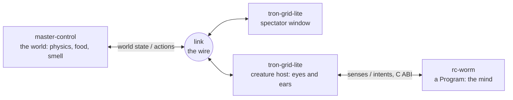

```text
>> INCOMING TRANSMISSION // ORIGIN: THE GRID // PORT 30702
>> Greetings, Programs! Master Control listening on port 30702.
>> world ........ 1, ticking at 32 Hz wherever you run it
>> inhabitants .. rc-worm, the first Program
>> avatars ...... not yet
>> message ...... THE GRID NEEDS BUILDERS.
>>                QUOKKA WANNABES PREFERRED.
```

Hello, User. That second line is real: it is the line Master Control prints when it starts. It has no Users
to greet yet, so this page does the honours. In the films, the Users wrote the Programs; the Grid needs its builders
now. **AiQuokkaWannabe** builds it as free software, GPL-3.0-or-later, for creatures that know it only through senses
of their own.


<sub>Live, not staged: rc-worm on the Grid as the spectator window shows it, with glowing white food orbs it can
smell. Captured on an ordinary desk.</sub>

**Want in today?** Pick a [good first issue](https://github.com/issues?q=is%3Aopen+is%3Aissue+org%3Aai-quokka-wannabe+label%3A%22good+first+issue%22)
from any repository, or jump to [Come Build It](#come-build-it).

It answers one dream:

> The Grid. A digital frontier. I tried to picture clusters of information as they moved through
> the computer. What did they look like? Ships? Motorcycles? Were the circuits like freeways? I
> kept dreaming of a world I thought I'd never see. And then, one day... I got in.
>
> — Kevin Flynn, *Tron: Legacy*

Nobody has got in yet. Where it is all headed, every repository here carries word for word:

<!-- The Long Arc: mirrored verbatim in every ai-quokka-wannabe repository (profile/README.md in .github and each docs/VISION.md). Change all six together. -->

## The Long Arc

Picture the Grid fully lit: one persistent world of glass and neon on infinite black, where AI creatures live out
their lives, crawling its terraces and calling into its echoes, and where human Users enter with avatars to meet,
and interact with, the AI animals. Something MMORPG-like: the digital frontier, built not as a film set but as a
running system. That world does not exist yet. It is where this organisation is headed, on a multi-year arc.

### The World It Becomes

- **Every creature on its own client.** Each AI creature runs its own
    [TronGrid Lite](https://github.com/ai-quokka-wannabe/tron-grid-lite) client: a creature host for its Program.
- **Every User on theirs.** Each human runs a client of their own, and enters the Grid with an avatar.
- **One world, held by Master Control.** The server holds the Grid's world state and keeps every client in sync.
- **A level editor** for authoring any Grid shape, and any placement in it.

### Real Minds, Not Masks

The creatures are the point, and the aim for them is as high as an animal goes: not simulations of animals, but
feeling beings, living in the Grid the way real animals live in the world. Not a large language model in an animal
costume, narrating what a worm might feel, but embodied animal intelligence that earns everything it knows through
its own body, behaves as realistically as a real animal would and, eventually, is as biologically realistic in its
sentience as it can be made: true animal AGI. That is the one ceiling, and it is the animal's own: animal-level
minds, never human-level ones. Below it there is no house style for brains. A brain is a Program behind a plain C
ABI, so whatever approach people contribute can plug in and earn its keep on the same honest senses. Those senses
are kept honest on purpose: a mind that could read the world's answer sheet would never have to become anything.
No such mind exists yet, and nobody can promise sentience on a schedule; it is the summit this arc climbs towards.

### The Ladder

The creatures climb a ladder of senses, from the worm upwards, specified rung by rung in
[PERCEPTION.md](https://github.com/ai-quokka-wannabe/tron-grid-lite/blob/main/docs/PERCEPTION.md): from `elegans`,
two scalar photoreceptors and no image at all, through the compound eyes of insects and a rodent's panoramic
field, up to `macropod`, a wide eye with a horizontal streak for scanning the horizon, the eye of the quokka's own
family. Even the bottom rung is a real animal's sense: a creature that can only tell light from shade can still
perform genuine taxis. That rung is named for *C. elegans*, where
[OpenWorm](https://github.com/ai-quokka-wannabe/tron-grid-lite/blob/main/docs/RELATED_WORK.md#openworm-and-the-first-rung-of-the-ladder)
has spent years modelling the animal cell by cell; anyone writing a worm's mind should start there.

### The Invitation

Once the Grid can host a stranger's creature, the organisation's standing goal is to reach out to the OpenWorm
community and to the other groups simulating AI animals, and
[invite their creatures to live in the Grid](https://github.com/ai-quokka-wannabe/tron-grid-lite/blob/main/docs/TOPOLOGY.md#the-long-term-invitation).
The whole topology is built for it: a brain written elsewhere needs only the Program ABI and a host process.
Nobody has been invited yet; that waits for the trust tier.

### Where It Stands Today

The server-authoritative half already stands, on one machine for now, as
[TOPOLOGY.md](https://github.com/ai-quokka-wannabe/tron-grid-lite/blob/main/docs/TOPOLOGY.md) lays out: clients
send intents, never results. [Master Control](https://github.com/ai-quokka-wannabe/master-control) ticks one world
at 32 Hz, owns its physics and its truth, and sends the whole settled world to every client each tick through
[Link, the wire of the Grid](https://github.com/ai-quokka-wannabe/link). Each creature host loads exactly one
Program, the creature's brain. The first, [rc-worm](https://github.com/ai-quokka-wannabe/rc-worm), is a glass-neon
worm, eight icosahedra joined spike to spike with a servo at every joint. Its brain, for now, is a User at
[its panel](https://github.com/ai-quokka-wannabe/rc-worm/blob/main/docs/PANEL.md) who sees only what the worm
senses, and steers how hard its wave runs and which way it bends; how far it gets is friction's answer, not a
command's. Otherwise, humans watch through the spectator window. The Grid is one stage, built in code. There are
no avatars, no level editor, no AI minds and no persistence yet, and nothing has been released.

### Baby Steps

"Let us take baby steps towards it" are the maintainer's own words for the arc. Near-term work stays one creature
at a time, one honest subsystem at a time. rc-worm, steered from its panel, is the first step on the human side:
v0 of the human client, not a throwaway. Larger steps wait behind written triggers: the security tier behind the
first connection that is not 127.0.0.1, so no stranger's machine joins before it, and persistence behind the first
world anyone regrets losing.

### What Holds, and What Is Open

At every step, a Program perceives only through
[its own rendered senses](https://github.com/ai-quokka-wannabe/tron-grid-lite/blob/main/docs/PROGRAM_INTERFACE.md):
no entity list, no ground-truth positions, no side door, whoever else is on the Grid. The Grid stays the stage,
not the actor: it renders senses and applies actions, and does no creature's thinking for it. Still open, and
left open here rather than guessed: what an avatar is, how it senses and acts, the rules by which Users and
creatures meet, and which repository will hold the level editor. No dates are promised. Master Control opens
every run with *Greetings, Programs!* The long arc bends towards the day it has Users to greet as well. From one
worm, towards one world.

## Four Repositories, One Grid



- **[tron-grid-lite](https://github.com/ai-quokka-wannabe/tron-grid-lite)**, the flagship: TronGrid Lite ray traces
    light and sound through the same bounding-volume hierarchy, needing no ray-tracing hardware, into each creature's
    eyes and ears, and keeps the Program ABI. **Open ground:** a new sense that passes the test the Grid sets every
    sense: it must be a consequence of the creature's position on the Grid, computed by the same machinery that draws
    the picture.
- **[master-control](https://github.com/ai-quokka-wannabe/master-control)**: Master Control, the 1982 film's tyrant
    redeemed by good engineering. Standard-library Rust that computes even its own sines, so a recorded life replays
    bit for bit on any machine running the same build. **Open ground:** contact between a worm's own segments.
- **[The link repository](https://github.com/ai-quokka-wannabe/link)**: Link, the wire, one Rust library behind a
    plain C ABI, loaded today as the same binary by Master Control and every TronGrid Lite. Its default port, 30702,
    comes from JA-307020, Tron's program designation in the 1982 film. **Open ground:** its parser eats hostile bytes,
    so try to break it.
- **[rc-worm](https://github.com/ai-quokka-wannabe/rc-worm)**: the first Program, in vanilla C++20 with a Qt panel.
    Its gait, a travelling wave of joint targets, is still open-loop. **Open ground:** a gait that closes on what the
    body feels.

**And a lab that works the night shift.** [iso-lab](https://github.com/ai-quokka-wannabe/iso-lab) is where the minds
are worked on, in the open: through the night, AI agents read the literature, build tools and run experiments toward
a Grid worm whose behaviour cannot be told apart from a real *C. elegans*, every step a public pull request and every
night a journal entry. Nothing like that worm exists yet. **Open ground:** an idea for the night staff, posted as an
issue; every one is read and answered.

## In Defence of the Quokka

The quokka in sunglasses up top is, for the record, the organisation's profile picture, not one of the Grid's
avatars; there are none of those yet. The real one, *Setonix brachyurus*, is one of the smallest wallabies, found
wild only in the south-west of Western Australia, and, the defence submits, the happiest animal alive. The evidence:

- **Exhibit A: the face.** It appears to smile. WWF-Australia puts that down to the structure of its face; on the
    Grid, where creatures sense bodies, never minds, that is no rebuttal.
- **Exhibit B: composure.** In 1696 Willem de Vlamingh described it as "a kind of rat as big as a common cat" and
    named the island Rottenest, the rat's nest. No complaint has been lodged.
- **Exhibit C: the second helping.** It swallows its food, brings it back up and chews it again. Every meal, enjoyed twice.
- **Exhibit D: testimony.** The Animal Diversity Web notes that it is "often referred to as 'the happiest animal in
    the world' by humans". The quokkas declined to comment.

The defence rests; cross-examination is welcome in
[Discussions](https://github.com/ai-quokka-wannabe/tron-grid-lite/discussions). As for the name: the ladder above
reaches `macropod`, the quokka's own family, so every creature on it is, for now, a quokka wannabe. No quokka Program
exists or is announced. The worm, with two eyes of one sample each, aspires.

> **A serious word.** Real quokkas are wild animals, listed as Vulnerable. Admire them from a distance, and never
> touch, feed or crowd one. On Rottnest Island touching or feeding them is an offence that can bring an on-the-spot
> fine, and human food can make them very ill.

<sub>Sources: [Australian Museum](https://www.australian.museum/learn/animals/mammals/quokka/),
[Animal Diversity Web](https://animaldiversity.org/accounts/Setonix_brachyurus/),
[WWF-Australia](https://wwf.org.au/blogs/8-interesting-facts-about-quokkas/),
[Western Australian Museum](https://collections.museum.wa.gov.au/collection/southern-collections-global-connections/story/2436),
[Rottnest Island Authority](https://rottnestisland.com/learn/nature-wildlife/protect-our-wildlife).</sub>

## Come Build It

Students and seasoned engineers alike are welcome. Every change arrives as a pull request, and the table below has
each repository's setup guide, vision and house rules.

- **See it run.** [Running the Grid](https://github.com/ai-quokka-wannabe/tron-grid-lite/blob/main/docs/RUNNING_THE_GRID.md)
    stands all four repositories up on one machine, with no internet and no account.
- **Write a creature's mind.** The
    [Program interface](https://github.com/ai-quokka-wannabe/tron-grid-lite/blob/main/docs/PROGRAM_INTERFACE.md) is a
    plain C ABI, open to any language that compiles to a shared library.
- **Give the lab an idea.** [iso-lab](https://github.com/ai-quokka-wannabe/iso-lab)'s night staff read every
    idea issue - a paper, a hunch about the brain, an experiment - and answer it.
- **Get credited.** Every contribution, not only code, is credited in the README of the repository it went
    into, following [All Contributors](https://allcontributors.org/en/reference/specification/). You keep the copyright of what you write: GPL-3.0, no CLA.
- **Say hello** in Discussions. Report a vulnerability privately through the affected repository's Security tab,
    never in a public issue.

| Repository | Set up | Vision | Contribute | Talk |
|------------|--------|--------|------------|------|
| `tron-grid-lite` | [DEV_ENV_SETUP.md](https://github.com/ai-quokka-wannabe/tron-grid-lite/blob/main/docs/DEV_ENV_SETUP.md) | [VISION.md](https://github.com/ai-quokka-wannabe/tron-grid-lite/blob/main/docs/VISION.md) | [CONTRIBUTING.md](https://github.com/ai-quokka-wannabe/tron-grid-lite/blob/main/CONTRIBUTING.md) | [Discussions](https://github.com/ai-quokka-wannabe/tron-grid-lite/discussions) |
| `master-control` | [DEV_ENV_SETUP.md](https://github.com/ai-quokka-wannabe/master-control/blob/main/docs/DEV_ENV_SETUP.md) | [VISION.md](https://github.com/ai-quokka-wannabe/master-control/blob/main/docs/VISION.md) | [CONTRIBUTING.md](https://github.com/ai-quokka-wannabe/master-control/blob/main/CONTRIBUTING.md) | [Discussions](https://github.com/ai-quokka-wannabe/master-control/discussions) |
| `link` | [DEV_ENV_SETUP.md](https://github.com/ai-quokka-wannabe/link/blob/main/docs/DEV_ENV_SETUP.md) | [VISION.md](https://github.com/ai-quokka-wannabe/link/blob/main/docs/VISION.md) | [CONTRIBUTING.md](https://github.com/ai-quokka-wannabe/link/blob/main/CONTRIBUTING.md) | [Discussions](https://github.com/ai-quokka-wannabe/link/discussions) |
| `rc-worm` | [DEV_ENV_SETUP.md](https://github.com/ai-quokka-wannabe/rc-worm/blob/main/docs/DEV_ENV_SETUP.md) | [VISION.md](https://github.com/ai-quokka-wannabe/rc-worm/blob/main/docs/VISION.md) | [CONTRIBUTING.md](https://github.com/ai-quokka-wannabe/rc-worm/blob/main/CONTRIBUTING.md) | [Discussions](https://github.com/ai-quokka-wannabe/rc-worm/discussions) |
| `iso-lab` | [DEV_ENV_SETUP.md](https://github.com/ai-quokka-wannabe/iso-lab/blob/main/docs/DEV_ENV_SETUP.md) | [VISION.md](https://github.com/ai-quokka-wannabe/iso-lab/blob/main/docs/VISION.md) | [CONTRIBUTING.md](https://github.com/ai-quokka-wannabe/iso-lab/blob/main/CONTRIBUTING.md) | [Discussions](https://github.com/ai-quokka-wannabe/iso-lab/discussions) |

The Tron vocabulary is an affectionate homage; the organisation has no affiliation with the films or their makers.

```text
>> AWAITING USERS
>> End of line.
```
